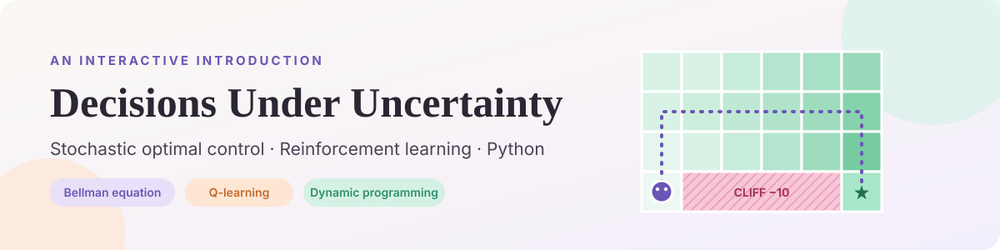
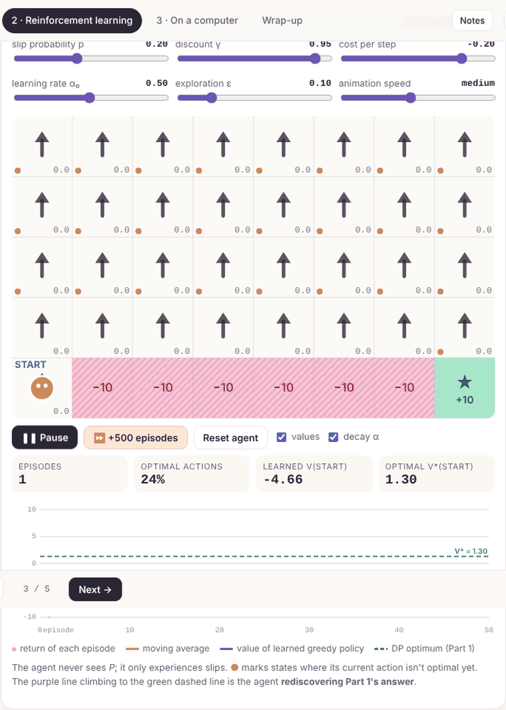
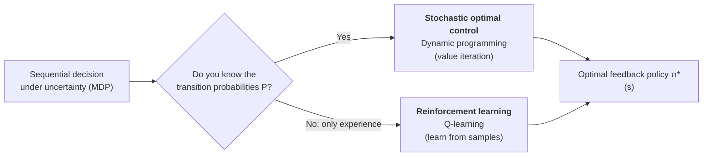
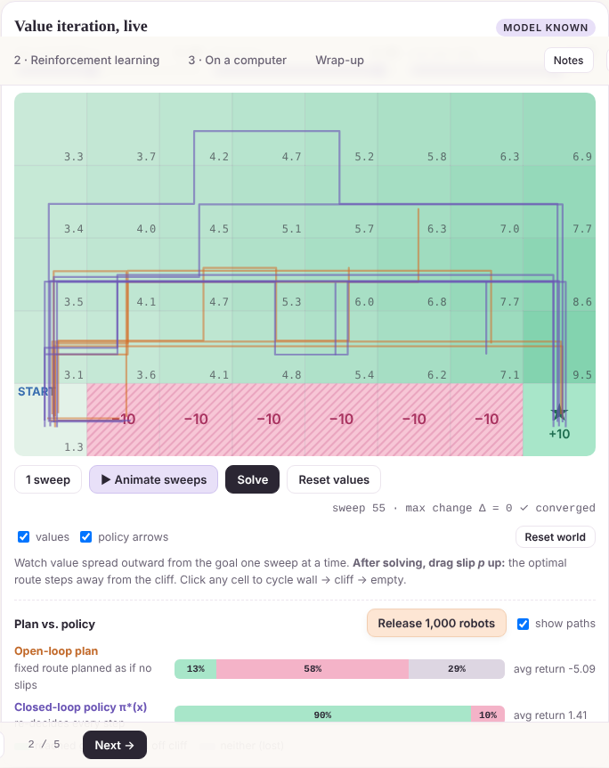
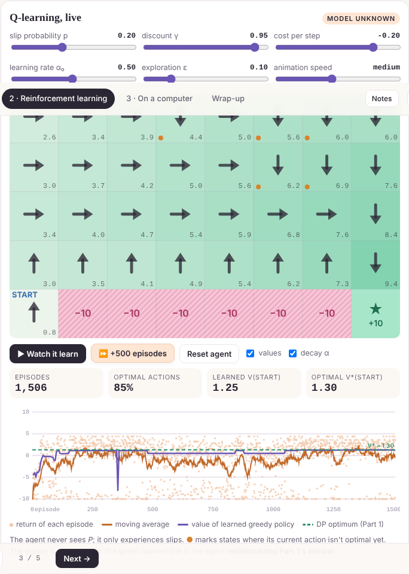

<p align="center">
  
</p>

<p align="center">
  <a href="https://lalalayla27.github.io/decisions-under-uncertainty/"></a>
  <a href="https://colab.research.google.com/github/lalalayla27/decisions-under-uncertainty/blob/main/stochastic_control_rl.ipynb"></a>
  
  
</p>

<p align="center"><b>How do you make the best decision when the world is random?</b><br>
This project answers that question twice, once with <i>math you can compute</i> and once with <i>an AI that learns</i>, using one slippery robot.</p>

---

## ✨ See it in action

<p align="center">
  
  <br><sub>A Q-learning agent starts with zero knowledge, falls off the cliff a lot, and gradually rediscovers the optimal policy. The purple line climbs to the green dashed optimum.</sub>
</p>

## 🤖 The setup

A robot on a 5 × 8 grid wants the **★ goal (+10)** and must avoid the **cliff (−10)**. Every move costs a little, and the floor is **slippery**: with probability *p* the robot slides sideways instead of going where it intended.

| | |
|---|---|
| **State** *s* | where the robot is |
| **Action** *a* | ↑ → ↓ ← |
| **Randomness** | intended move with probability 1 − *p*, otherwise a slide to either side |
| **Goal** | maximize expected discounted reward 𝔼[Σ γᵗ rₜ] |

## 🧭 Two ways to solve it



### 1 · Stochastic optimal control: *compute* the answer

Bellman's principle of optimality gives one equation for the best achievable value:

$$V^*(s) = \max_a \sum_{s'} P(s' \mid s,a)\,\big[r + \gamma V^*(s')\big]$$

**Value iteration** applies it to every state until nothing changes.



> **Insight:** as slip increases, the optimal route moves away from the cliff, because risk changes what's optimal. And a feedback *policy* reaches the goal about **89%** of the time, versus about **14%** for a fixed plan.

### 2 · Reinforcement learning: *learn* the answer

Don't know *P*? Replace the average with one real experience:

$$Q(s,a) \leftarrow Q(s,a) + \alpha\,\big[r + \gamma \max_{a'} Q(s',a') - Q(s,a)\big]$$



### 3 · The one-line difference

```python
# Stochastic control: average over EVERY possible next state using the model P
Q[s, a] = sum(p * (R[s2] + gamma * V[s2]) for p, s2 in P[s][a])

# Reinforcement learning: use the ONE next state that actually happened
Q[s, a] += alpha * (r + gamma * Q[s2].max() - Q[s, a])
```

## 📂 What's inside

| File | What it is |
|---|---|
| [`index.html`](index.html) | The interactive presentation: live value iteration, 1,000-robot Monte Carlo test, live Q-learning, and Python that runs in your browser |
| [`stochastic_control_rl.ipynb`](stochastic_control_rl.ipynb) | Companion notebook: value iteration, open- vs closed-loop simulation, Q-learning, and a 📦 **inventory-control** example where dynamic programming discovers the classic order-up-to policy |

## 🚀 Run it yourself

- **Easiest:** click **▶ Live demo** at the top. Use ← → to move between sections, **N** for speaker notes, **F** for fullscreen.
- **Notebook:** click **Open in Colab**, then *Runtime → Run all*.
- **Locally:** `pip install numpy matplotlib scipy jupyter`, then `jupyter notebook stochastic_control_rl.ipynb`.

## 📚 References

- Bellman, R. (1957). *Dynamic Programming.* Princeton University Press.
- Sutton, R. & Barto, A. (2018). *Reinforcement Learning: An Introduction* (2nd ed.). MIT Press.
- Bertsekas, D. (2019). *Reinforcement Learning and Optimal Control.* Athena Scientific.
- Watkins, C. & Dayan, P. (1992). Q-learning. *Machine Learning*, 8, 279–292.
- Powell, W. (2022). *Reinforcement Learning and Stochastic Optimization.* Wiley.

---

<p align="center"><sub>Made by <b>Lay Pyae Phoe Pyi Sone</b> · M.S. Business Analytics, University of Central Florida</sub></p>
